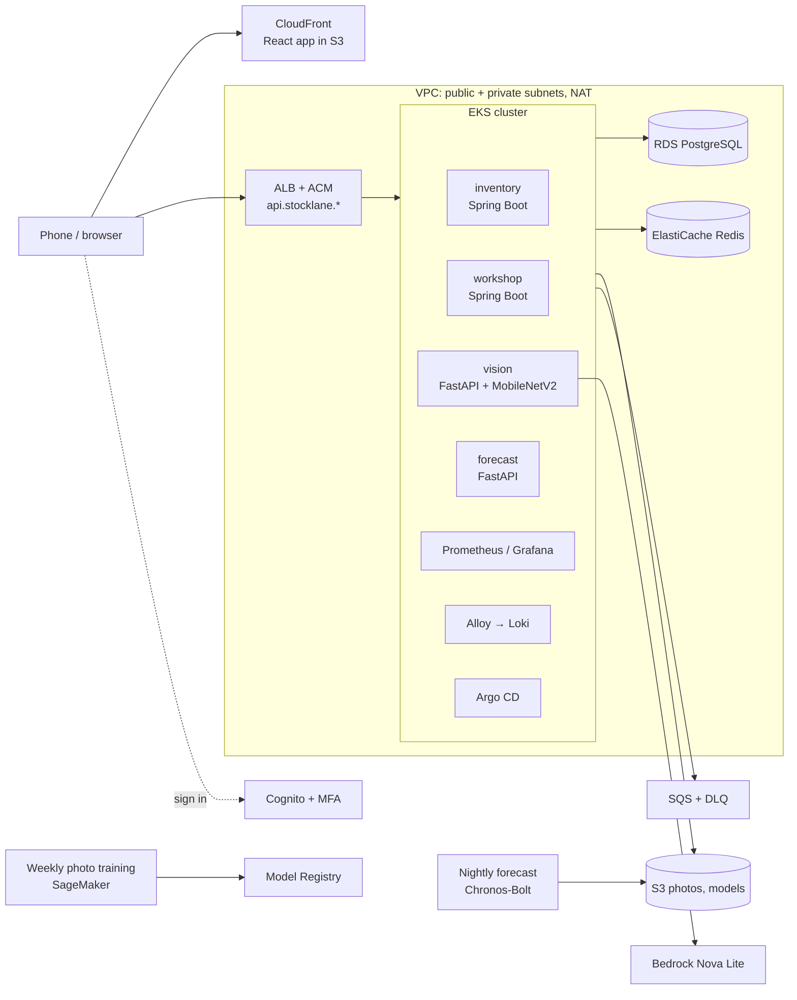
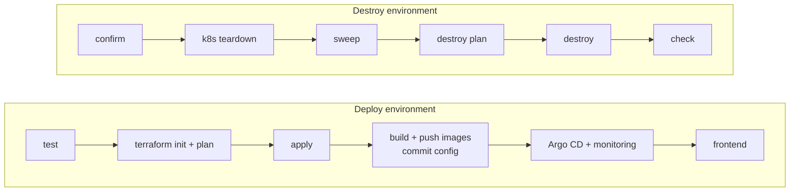

# Stocklane — workshop stock management on AWS

A stock-management system for a vehicle workshop, built around one problem: **parts go
missing and nobody knows who took them or when to reorder.** Everything that enters or
leaves the storeroom is recorded at the *storeroom counter* (received, given to a named
person, taken back), by scanning a QR label or taking a photo. The owner gets a plain
stock report and a reorder list that update by themselves.

It runs as microservices on **Amazon EKS**, is built entirely with **Terraform +
GitHub Actions + Argo CD**, and has a **dev** environment that can be created and destroyed
with one pipeline run. Prod is added later by copying dev (see [infra/README.md](infra/README.md)).

## Run it from zero

Repository name used below: `stocklane-aws-gitops-mlops-llmops-platform`. Replace every `<...>` with your own value.
Only `dev` exists. Nothing is created by hand in GitHub Environments: GitHub creates them on the first run.

### Step 1: Collect these values first

| Value | Where to find it |
| --- | --- |
| `<ACCOUNT_ID>` | AWS console, account menu (top right), 12 digits |
| `<ZONE_ID>` | Route 53 → Hosted zones → your domain → Hosted zone ID (`Z...`) |
| `<DOMAIN>` | Your domain, for example `example.com` |
| `<MY_IP>` | Open `https://checkip.amazonaws.com` in your laptop browser (not in CloudShell) |
| `<ADMIN_ARN>` | CloudShell: `aws sts get-caller-identity --query Arn --output text`. If it shows `assumed-role/NAME/session`, use `arn:aws:iam::<ACCOUNT_ID>:role/NAME` (for SSO the role is `AWSReservedSSO_...`, find it with `aws iam list-roles`) |
| `<EMAIL>` | Where budget alerts go |

Optional: Bedrock access to `amazon.nova-lite-v1:0` in `us-east-1` (Textract is the fallback).

### Step 2: Create the GitHub repository (browser)

1. github.com → **New repository** named `stocklane-aws-gitops-mlops-llmops-platform`, empty (no README, no .gitignore).
2. In the extracted project folder:

```bash
git init -b main && git add . && git commit -m "Initial commit"
git remote add origin https://github.com/<owner>/stocklane-aws-gitops-mlops-llmops-platform.git
git push -u origin main
```

### Step 3: Foundation stack (AWS CloudShell, region `ap-southeast-2`, once)

```bash
git clone https://github.com/<owner>/stocklane-aws-gitops-mlops-llmops-platform.git
cd stocklane-aws-gitops-mlops-llmops-platform
export AWS_REGION=ap-southeast-2 AWS_DEFAULT_REGION=ap-southeast-2
export REPOSITORY=<owner>/stocklane-aws-gitops-mlops-llmops-platform EXPECTED_ACCOUNT=<ACCOUNT_ID> \
       HOSTED_ZONE_ID=<ZONE_ID> API_DOMAIN=api.stocklane.<DOMAIN>

bash infra/ci/bootstrap.sh                                 # creates a change set only, review it
EXECUTE=1 CREATE_ACCESS_KEY=1 bash infra/ci/bootstrap.sh   # first real run
```

`CREATE_ACCESS_KEY=1` is for the first run only. Later runs use `EXECUTE=1` alone.
The script creates the CI user and, with `CREATE_ACCESS_KEY=1`, writes its access key to
`deploy/generated/github-credentials.json` **inside CloudShell** (private, git-ignored, shown once).
That file is where the two AWS keys in Step 5 come from.

### Step 4: Build the `TFVARS_JSON` value (CloudShell)

```bash
cat > /tmp/tfvars.json <<'JSON'
{
  "administrator_arn": "<ADMIN_ARN>",
  "operator_cidrs": ["<MY_IP>/32"],
  "admin_allowed_cidrs": ["<MY_IP>/32"],
  "route53_zone_id": "<ZONE_ID>",
  "api_domain": "api.stocklane.<DOMAIN>",
  "web_domain": "stocklane.<DOMAIN>",
  "argocd_domain": "argocd.stocklane.<DOMAIN>",
  "grafana_domain": "grafana.stocklane.<DOMAIN>",
  "budget_email": "<EMAIL>",
  "github_oidc_subject_style": "immutable",
  "github_auth_mode": "access-key",
  "bedrock_model_id": "amazon.nova-lite-v1:0",
  "bedrock_region": "us-east-1"
}
JSON
jq . /tmp/tfvars.json > /dev/null && echo "JSON ok"
```

Every hostname must contain `stocklane`. The two admin hostnames (Argo CD, Grafana) share one ALB that only
accepts `admin_allowed_cidrs`, so keep that list to your own IP. The repository ID, CI user ARN and boundary
ARN are added by the workflow.

### Step 5: GitHub variables and secrets (browser)

Repository → **Settings → Secrets and variables → Actions**.

**Variables** tab, *New repository variable*:

- `AWS_ACCOUNT_ID` = `<ACCOUNT_ID>`
- `AWS_AUTH_MODE` = `access-key`

**Secrets** tab, *New repository secret*. Print the values in CloudShell and copy them across:

```bash
cat deploy/generated/github-credentials.json     # shows AccessKeyId and SecretAccessKey
cat /tmp/tfvars.json
```

- `AWS_ACCESS_KEY_ID` = the `AccessKeyId` value
- `AWS_SECRET_ACCESS_KEY` = the `SecretAccessKey` value
- `TFVARS_JSON` = the whole content of `/tmp/tfvars.json`

Then wipe the private files in CloudShell: `shred -u /tmp/tfvars.json deploy/generated/github-*.json`

### Step 6: Deploy

**Actions → Deploy environment → Run workflow** on `main` (`environment` = `dev`, `allow_deletions` off). About 50 minutes.
If the plan would delete or replace anything, the run stops so you can read the plan summary first.
The run summary prints the app, API, Argo CD and Grafana URLs.

### Step 7: Check it works (CloudShell)

```bash
aws eks update-kubeconfig --name stocklane-dev --region ap-southeast-2
kubectl get applications -n argocd          # all Synced / Healthy
kubectl get pods -n stocklane-dev
kubectl get pods -n monitoring
```

- **App:** Cognito emails a temporary password to `budget_email`. Set a new password (14+ characters) and MFA.
- **Grafana:** user `admin`, password in Secrets Manager `stocklane-dev/grafana/admin` (field `password`). Logs: **Explore → Loki**, for example `{namespace="stocklane-dev"} |= "ERROR"`.
- **Argo CD:** user `admin`, password from `kubectl -n argocd get secret argocd-initial-admin-secret -o jsonpath='{.data.password}' | base64 -d`.

### Step 8: Destroy (stops the billing)

**Actions → Destroy environment**, type `dev` in `confirm`. The final check fails if anything billable is left.


### Troubleshooting

- **State lock left by a cancelled run:** delete `state/dev/terraform.tfstate.tflock` in the state bucket.
- **A destroy stage failed half way:** re-run Destroy; every step is idempotent.
- **Cannot reach the EKS API from your machine:** `operator_cidrs` must hold your current public IP.
- **An Argo CD application is `Degraded`:** open it in Argo CD and read the Events tab. All six chart
  versions were checked against the upstream release tags and the Helm values keys against each chart's
  `values.yaml`, but nothing has been installed on a real cluster yet. Apps retry 10 times with backoff, so
  wait ~15 minutes before treating a CRD-ordering error as real.
- **Add prod later:** see "Adding prod later" in [infra/README.md](infra/README.md).

## Architecture



- **Security:** private worker subnets, Pod Identity role per service account
  with a permissions boundary, Secrets Manager via External Secrets, KMS, network
  policies, non-root containers, Cognito with MFA.
- **Observability:** kube-prometheus-stack (Prometheus, Grafana) for metrics, Alloy → Loki for logs
  (7-day retention), both read in Grafana. CloudWatch alarms (queues, database) → EventBridge → a Lambda root-cause summary → SNS email. Plus a budget.
- **AI/MLOps:** a pretrained forecasting model, a photo matcher that retrains itself and
  Bedrock label reading, all with quality gates and no manual approval
  ([docs/MLOPS.md](docs/MLOPS.md)).

## Repository layout

```text
apps/web/                 React frontend
services/                 inventory, workshop (Spring Boot) · vision, forecast (FastAPI) · operations (DB bootstrap), each with its own Dockerfile
models/                   baseline image-model download (first deploy)
mlops/forecast/           nightly stock forecast (Chronos-Bolt)
mlops/vision/             photo model: training, registry, promotion (+ Dockerfile of the training image)
infra/
  ci/                     foundation: CI roles + state bucket (CloudFormation, once)
  terraform/modules/      network, data, registry, eks, workload-identity, edge,
                          auth, ml, observability, cicd
  terraform/environments/ dev (same main.tf, small tfvars)
kubernetes/               Kustomize base + dev, Argo CD app-of-apps, Helm values
deploy/codebuild/         private in-VPC runner for the cluster bootstrap
.github/workflows/        deploy, destroy, ci, train, forecast, release-model (inline shell, no scripts)
```

Only `dev` exists: Terraform environment `dev`, namespace `stocklane-dev`, Argo CD
application `stocklane-dev`. Sizes: 2 AZs with one shared NAT, 2 × m7i-flex.large nodes,
db.t4g.micro, 1–2 app replicas (HPA at 70% CPU), `deletion_protection = false`.

## Pipelines



**One workflow creates everything; one destroys it.** Each is a single file with
plain shell steps (the same style as any small CI repo). There are no helper scripts.

| Stage | What happens |
| --- | --- |
| checks | `ci.yml`: Java and frontend build, Python compile check, `terraform validate` (no AWS calls), Kustomize build + kubeconform schema check, actionlint, cfn-lint, Trivy |
| init + plan | the real `terraform init` against the S3 state, then a plan that stops the run if it would delete or replace anything (unless `allow_deletions`) |
| apply | applies **exactly** that saved plan file. This creates the ECR repositories, so images can only be pushed after it |
| build + push | builds the four service images, the web app and the photo-training image, pushes them to ECR by digest, writes the dev config and image digests and commits them to `main` (GitOps) |
| Argo CD + monitoring | a private CodeBuild runner inside the VPC installs Argo CD; Argo CD syncs the release commit, including Prometheus, Grafana, Loki and Alloy; HTTPS probe |
| frontend | publishes the React build to S3 and invalidates CloudFront |

Destroy first removes what Kubernetes created in AWS (load balancers, volumes,
DNS records), then runs a reviewed `terraform destroy`, then **checks that
nothing billable is left**. Only the state bucket, CI roles and hosted zone stay.

Setup and usage: see [Run it from zero](#run-it-from-zero).

## Spring Boot service structure

There are two Spring Boot microservices, `services/inventory` and
`services/workshop`. Each one is **self-contained** (its own `pom.xml`, security,
exception handling, migrations, Docker image and database schema) and has the
same layered layout:

```text
services/<service>/src/main
├── java/com/stocklane/<service>/
│   ├── <Service>Application     Spring Boot entry point
│   ├── controller/              REST endpoints and role checks (@PreAuthorize)
│   ├── service/                 business rules, transactions, calls to other services and AWS
│   ├── repository/              all SQL (JdbcTemplate), one class per table group
│   ├── dto/                     request bodies (Java records)
│   ├── config/                  SecurityConfig: Cognito JWT, service tokens, CORS
│   └── exception/               ConflictException (409), NotFoundException (404), GlobalExceptionHandler
└── resources/                   application.yml, db/migration (Flyway SQL)
```

Requests go `controller → service → repository → PostgreSQL`. The two services
call each other only over HTTP and an SQS-backed outbox (inventory events update
workshop job allocations). Routing between services is done by the ALB ingress,
so there is no separate API-gateway service.

`service/Commands` (idempotent requests: the same `Idempotency-Key` returns the
same result) and the `config` and `exception` classes are copied into both
services so that each can be built and deployed on its own. Keep the copies identical when you change one.

## Design decisions worth explaining

- **Modules + per-environment roots instead of workspaces.** Each environment has
  its own state file and its own small `terraform.tfvars`; the code is identical
  so differences between environments stay visible in one file.
- **Saved plan.** Apply uses the plan file from the same job, and a plan that deletes
  or replaces resources stops the run first.
- **Private runner for the cluster.** The EKS API is restricted to the operator's
  IP, so cluster bootstrap runs on CodeBuild inside the VPC.
- **One Dockerfile and one pom per service.** Each service folder holds its own `Dockerfile` (and `pom.xml`
  for the two Java services), with no shared parent. Build from the repository root, for example
  `docker build -f services/vision/Dockerfile .`, because the forecast and training images reuse small
  files from `services/vision`. Images that talk to PostgreSQL download the RDS CA bundle from AWS while building.
- **GitOps.** The pipeline never runs `kubectl apply` for apps; it commits the
  generated config and image digests, and Argo CD makes the cluster match Git.
- **Helm charts via Argo CD** for third-party components, each as one Application with
  a pinned version and a small values file, so the repository stays a few dozen YAML files.
- **App-of-apps and sync waves.** The bootstrap installs only Argo CD and `stocklane-root`;
  Argo CD orders the rest itself.
- **One switch for disposability.** `deletion_protection=false` turns off DB snapshots,
  bucket retention and secret recovery windows so dev destroys cleanly.

## Models

| Model | What it does | How it runs |
| --- | --- | --- |
| Stock forecast | Pretrained **Chronos-Bolt** predicts how much of each item will be used | nightly job on a GitHub runner; each item is back-tested and released only if the test error is small; otherwise the reorder level is used |
| Photo matcher | MobileNetV2 features plus a calibrator trained on photos people confirmed | retrains every Sunday on SageMaker; approved and rolled out by itself only if it beats the served model |
| Label reading | Textract, then Bedrock tool use, suggests the name, brand and size | on demand, when a new item is photographed |

## Using it

There is no local setup. Push to `main`, run **Deploy environment**, open the app URL.
Passwords are generated and kept in Secrets Manager. See [Run it from zero](#run-it-from-zero).

## More docs

| Doc | Topic |
| --- | --- |
| [infra/README.md](infra/README.md) | Terraform modules and environments |
| [kubernetes/README.md](kubernetes/README.md) | Kubernetes layout, Argo CD |
| [docs/MLOPS.md](docs/MLOPS.md) | Models, nightly forecast, weekly photo training, Bedrock |
| [docs/OPERATIONS.md](docs/OPERATIONS.md) | Stock rules, alerts, recovery drills |
